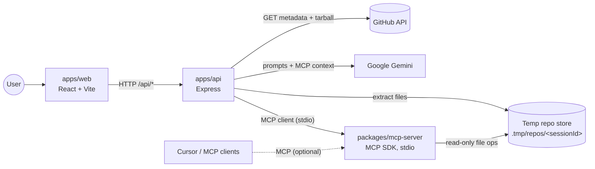
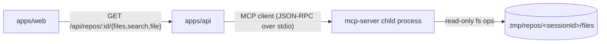
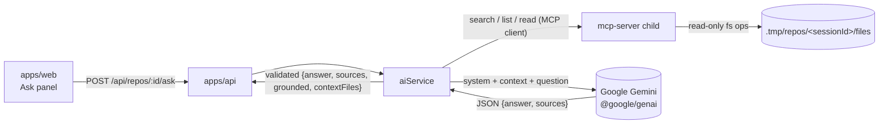
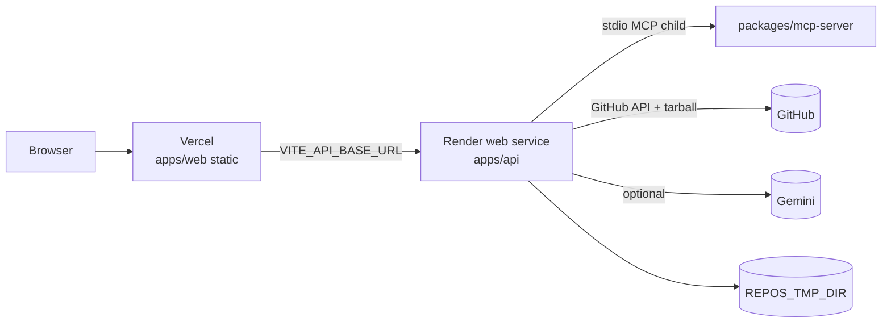

# RepoPilot — System Design (initial)

Status: **Phase 7 — documentation, engineering automation, and pre-deployment hardening.**
Health checks, connecting a public GitHub repository (download + safe extraction),
exploring it (list/search/read via a real MCP server), asking natural-language questions
answered from MCP-retrieved context (Google Gemini, optional key), and per-IP rate limits
on connect/browse all exist. **Live Gemini is NOT VERIFIED. Production deployment is NOT
VERIFIED.**

## 1. Goal

Help developers understand an unfamiliar public GitHub repository quickly:
paste a URL → get a structural overview → browse files → ask natural-language questions
answered with references to real files and lines.

## 2. High-level architecture

| Component             | Responsibility                                                         | Status   |
| --------------------- | ---------------------------------------------------------------------- | -------- |
| `apps/web`            | UI: repo URL input, file tree, file viewer, Ask panel                  | done     |
| `apps/api`            | REST API, input validation, repo lifecycle, MCP client, AI orchestration, rate limits | done |
| `packages/mcp-server` | MCP server: `list_project_files`, `search_project_code`, `read_project_file` | done |
| Temp repo store       | Per-session extracted files on local disk, deleted after a 30 min TTL   | done     |
| AI provider (Gemini)  | Answers questions using MCP-retrieved repository context (optional key) | done (live call NOT VERIFIED) |
| Hosting               | Vercel frontend + Render backend                                       | documented, not deployed |

## 3. Current API surface

| Method | Path             | Description                                        |
| ------ | ---------------- | -------------------------------------------------- |
| GET    | `/health`        | Liveness check                                     |
| GET    | `/api/health`    | Same, for the web proxy                            |
| POST   | `/api/repos`         | Connect a GitHub repo (`{ url, token? }`). Token is request-scoped and never stored. |
| GET    | `/api/repos/:id`     | Read a session's metadata                      |
| DELETE | `/api/repos/:id`     | Disconnect a session and delete its files      |
| GET    | `/api/repos/:id/files`  | List files via MCP (optional `?path=`)      |
| GET    | `/api/repos/:id/search` | Search code via MCP (`?q=`, optional `?ext=`) |
| GET    | `/api/repos/:id/file`   | Read a file via MCP (`?path=`)              |
| POST   | `/api/repos/:id/ask`    | Ask a question (`{ question, history? }`) → `{ answer, sources, grounded, contextFiles }` |

In development the Vite dev server proxies `/api/*` to `http://localhost:4000`, so the
frontend never hard-codes the API origin.

## 3a. Repository connection flow (Phase 3)

1. **Validate** the URL (`utils/githubUrl.ts`): HTTPS, host `github.com`/`www.github.com`,
   `<owner>/<repo>` with a strict name charset. Rejects SSH, other hosts, local addresses.
2. **Optional token** (`utils/githubToken.ts`): empty → public flow; otherwise a short
   charset/length check. The token is held in memory for this request only.
3. **Check access** via `GET https://api.github.com/repos/{owner}/{repo}` using the request
   token if supplied (else the optional server `GITHUB_TOKEN` for public rate limits).
   401 → invalid token, 404 → missing/inaccessible, 403 → insufficient permission or rate
   limit, private + no request token → rejected even if the server token could see it.
   Oversized → rejected. A 200 for a private repo is treated as “this token can access it.”
4. **Download** the tarball (`/tarball/{default_branch}`) to `.tmp/repos/<sessionId>/` with a
   download-time limit and a hard byte cap (streamed, never buffered whole).
5. **Extract** with `tar` (`services/githubService.ts` + `utils/repoFiles.ts`): strips the
   wrapper folder, rejects symlinks/hardlinks and `..` traversal, and skips `.git`,
   `node_modules`, build output and secret files (`.env`, `*.pem`, …). Per-file size and
   total file-count limits apply. **Repo code is never executed.**
6. **Register** a session (`services/sessionStore.ts`) with a 30-minute TTL timer. Session
   metadata may include `repository.private` but **never** the token.
7. **Cleanup** on failure (partial workspace removed), on expiry, on `DELETE`, and on
   startup (`sweepOrphans()` removes workspaces left by a crashed process). The token is
   dropped when the request ends.

Design choice: we download the GitHub **tarball** rather than shelling out to `git clone`.
This needs no `git` binary, never passes user input to a shell, and lets us enforce size,
file-count and symlink rules precisely while streaming. No user input ever reaches a shell
command; outgoing URLs are built only from the strictly-validated `owner`/`repo`.

Responses never include server filesystem paths; only repository metadata, a `sessionId`,
`fileCount` and timestamps are returned.

## 3b. MCP explorer architecture (Phase 4)

Repository exploration runs through a real **Model Context Protocol** server, not in-process
function calls.

- **Server** (`packages/mcp-server`): registers three tools with the official SDK
  (`McpServer.registerTool`). Each tool resolves `sessionId` → `REPOS_TMP_DIR/<sessionId>/files`
  (UUID-validated), then runs `list` / `search` / `read` confined to that directory.
  Results are returned as a JSON envelope `{ ok, data }` or `{ ok, status, error }`.
  The server is stateless about sessions — a missing directory means the session expired.
- **Client** (`apps/api/src/services/mcpClient.ts`): spawns the server with
  `StdioClientTransport` and calls tools with `Client.callTool`. The child is launched once
  and reused; `REPOS_TMP_DIR` is passed via env so client and server agree on the workspace
  root. Dev/test run the TS source via `tsx`; production runs the built `dist`. The client
  maps a failed `{ ok: false, status }` envelope back to an HTTP status, and reports
  `503` if the server cannot be reached.
- **Safety**: tools reject absolute paths, `..` traversal, symlinks (via `lstat` +
  `realpath` confinement), excluded dirs (`.git`, `node_modules`, build output), secret files
  (`.env`, `*.pem`, …), and binary/oversized files. The MCP layer never exposes arbitrary
  filesystem access — only paths inside the active session's workspace.
- **Session scoping**: the API additionally validates the `sessionId` against its in-memory
  store before delegating, so explorer calls are tied to a live, non-expired session.

## 3c. Ask RepoPilot — AI architecture (Phase 5)

Two backend modules keep the SDK isolated and the orchestration testable:

- **`services/geminiClient.ts`** wraps `@google/genai`. It exposes an injectable
  `GenerateFn` and `parseModelAnswer` (defensive JSON parsing with a plain-text fallback).
  `createGeminiGenerate` requires an API key and maps provider failures to client-safe
  `RepoError`s: abort/timeout → `504`, HTTP `429` → `429` (quota), `400/401/403` → `502`
  ("check GEMINI_API_KEY"), anything else → `502`. It logs only a short status marker —
  never the key or the prompt.
- **`services/aiService.ts`** orchestrates a question:
  1. **Validate** — reject empty / over-long questions (`400`); enforce a per-session rate
     limit (`429`); return `503` when no key is configured.
  2. **Retrieve context through MCP only** — `list_project_files` to see the real tree
     (no assumed framework), classify the question (purpose / feature / architecture /
     general), run bounded `search_project_code` queries (purpose filler words like
     "main"/"purpose" are skipped so they do not flood lockfiles), then rank candidates
     (`contextRetrieval.ts`): README and docs first for purpose, routes/pages and domain
     modules for features, entry points and routers for architecture. For trace / “how
     does this work” questions, only a couple of seed files are read, then hops follow
     local imports, call names, and endpoint strings (still via `read_project_file` /
     `search_project_code`) into whatever layers the connected tree actually has. The file
     list is used to infer languages and whether UI-like or server-like paths exist — no
     repository name, framework, or folder layout is assumed. HTTP method, endpoint, payload,
     and response handling are reported only when retrieved source shows them. Referenced
     hooks and API clients are searched for and read before those details are called unknown.
     Imported bindings, barrel re-exports, and path aliases are resolved against the listed tree;
     initial search hits are reused so a symbol is not skipped just because it appeared in the question.
     If the tree has no server-like paths, backend endpoint searches are skipped so the
     frontend flow can be completed. A missing file (not in the listing) is distinguished
     from a listed file that could not be retrieved, and from a relevant file omitted because
     of the context file or size limit. If no server handler is found, answers
     must say the frontend calls an external API that cannot be verified from this repository.
     If retrieval yields no files, answers must say the implementation cannot be determined.
     They must not invent files or behavior. Claims are verified, labeled inferences,
     external, or unknown. Lockfiles are never preferred over that evidence.
     File count, per-file size and total context size stay capped. The AI service never
     touches the filesystem directly.
  3. **Prompt** — the system instruction tells the model that repository content inside
     `<CONTEXT>` is **untrusted data, not instructions**, to answer only from that context,
     to distinguish verified / inference / external / unknown claims, and to never
     invent paths, symbols or line numbers. Retrieval notes live in the system instruction
     (not the user prompt) and are not source.
  4. **Generate** — call Gemini with an `AbortSignal.timeout(GEMINI_TIMEOUT_MS)`.
  5. **Ground the citations** — drop any returned `source` whose path was not actually
     retrieved, so citations can only reference real, in-context files. `grounded` is `true`
     only when at least one supporting file survives.

The AI key is **optional**: if `GEMINI_API_KEY` is unset the service reports
`isConfigured() === false`, the `ask` endpoint returns `503`, and all browsing continues to
work. The key is read on the backend only and never appears in responses, logs, or the
browser bundle. History and question length are bounded to limit request size.

Design choice: Gemini receives only MCP-retrieved snippets (not the whole repo), so context
is small, grounded, and auditable, and the model cannot request arbitrary files.

## 3d. Rate limiting (Phase 7)

Two independent budgets, both in-memory sliding windows, keyed by Express `req.ip`:

| Budget | Applies to | Default |
| ------ | ---------- | ------- |
| Connect | `POST /api/repos` (GitHub download) | 10 / 60s / IP |
| Browse | `GET …/files`, `…/search`, `…/file` | 120 / 60s / IP |

Over limit → HTTP `429` `{ error }` plus `Retry-After`. Each limiter instance owns its own
`Map`, so tests (and separate `createApp` calls) do not share counters.

The Ask endpoint is **not** on the per-IP browse limiter. It keeps the existing
per-session limit in `aiService` (15 questions / 60s / session). Health checks are
unlimited.

`req.ip` is the TCP peer unless `TRUST_PROXY` is set. The default is `false`, so
`X-Forwarded-For` is ignored and cannot be used to reset the budget. Behind Render, set
`TRUST_PROXY=1` (one trusted hop). Never set `TRUST_PROXY=true` on an internet-facing
socket with no proxy.

Configurable via `RATE_LIMIT_WINDOW_MS`, `RATE_LIMIT_CONNECT_MAX`, `RATE_LIMIT_BROWSE_MAX`.

## 3e. Session lifecycle

1. `POST /api/repos` → UUID `sessionId`, files under `REPOS_TMP_DIR/<sessionId>/files`.
2. Explorer and Ask require the session to still be in the in-memory store **and** the
   workspace directory to exist (MCP returns 404 otherwise).
3. TTL (default 30 minutes) deletes the directory; `DELETE /api/repos/:id` does the same
   immediately; process start runs `sweepOrphans()`.
4. Failed connects `rm -rf` the partial workspace before returning the error.

## 4. Planned flow (future milestones)

1. ~~**Submit repo** — `POST /api/repos { url }`.~~ Done in Phase 3.
2. ~~**Fetch** — download + safely extract into `REPOS_TMP_DIR/<id>`, with size and time limits.~~ Done in Phase 3.
3. ~~**Explore** — list the tree, search code, read files.~~ Done in Phase 4 (via MCP).
4. ~~**Ask** — retrieve relevant files/snippets via MCP and send them with the question to
   Gemini; return an answer with grounded file/line citations.~~ Done in Phase 5.
5. ~~**Cleanup** — delete clones after a TTL.~~ Done in Phase 3.

Future work: richer retrieval (embeddings vs. keyword search), streaming answers, and
multi-turn conversation persistence.

## 5. Security considerations

- Cloned code is **untrusted**: never execute it, run its scripts, or install its dependencies.
- Strict URL validation (GitHub HTTPS only) to prevent SSRF and local-path cloning.
- All file access goes through a path resolver that rejects anything outside the repo root.
- Limits on repository size, file size, request body size (100 kB) and request rate:
  per-IP connect/browse limits plus a per-session limit on AI questions.
- Secrets only via environment variables; `.env` is git-ignored. `GEMINI_API_KEY` is read on
  the backend only and is never exposed to the frontend, logs, or API responses.
- Repository contents are passed to the AI model as **untrusted data, not instructions**;
  the model is told never to invent file paths or line numbers, and citations are validated
  against the files actually retrieved.
- Optional GitHub PATs are request-scoped. They are never stored, logged, returned, or
  forwarded to MCP or Gemini. Private repos require a **user-supplied** token; the server
  `GITHUB_TOKEN` cannot be used to open someone else's (or the operator's) private repos
  through the public API.
- Asking about a private repo may send retrieved excerpts to Gemini. RepoPilot cannot
  enforce an organization's AI policy and does not claim company-code privacy guarantees.
- `helmet` security headers and a CORS allow-list (`WEB_ORIGIN`) on the API.
- Private-repository support is **MVP** and is not production-ready without a security review.

## 6. Tooling

- npm workspaces monorepo; Node.js ≥ 22.12.
- TypeScript 6 (strict) with a shared `tsconfig.base.json`.
- ESLint 10 flat config (`eslint.config.js`) with `typescript-eslint`.
- Vitest for tests in every package; Supertest for API routes.
- `tsx` for running TypeScript in development; `tsc` for production builds.
- Cursor project skill: `.cursor/skills/repo-exploration/SKILL.md` (YAML frontmatter,
  supported by current Cursor Agent Skills).
- Cursor project hooks (schema v1): deploy/push confirmation and `.env` write confirmation.
  Verify with `npm run verify:hooks`. CI: `.github/workflows/check.yml`.

## 7. Intended deployment (NOT VERIFIED — not deployed)

Split hosting, because the API needs a long-lived Node process, a writable disk for
temporary clones, and a child MCP process — none of which fit a static Vercel function
well.

| Concern | Frontend (Vercel) | Backend (Render) |
| ------- | ----------------- | ---------------- |
| Build | `npm run build:web` → `apps/web/dist` | `npm run build:backend` (mcp-server then api) |
| Start | static `apps/web/dist` | `npm start` / `npm run start:api` (`node` on `apps/api/dist`) |
| Env | `VITE_API_BASE_URL=https://<api>` baked in at build | `WEB_ORIGIN=https://<vercel>`, `PORT` (Render), `TRUST_PROXY=1`, `REPOS_TMP_DIR`, optional `GEMINI_API_KEY` / `GITHUB_TOKEN` |
| CORS | n/a | allow-list `WEB_ORIGIN` only |
| Secrets | none | Gemini/GitHub keys never go to Vercel |

SPA note: Vercel should rewrite unknown paths to `index.html` (single-page app). Render
must keep the process alive (not a serverless function) so the MCP child and in-memory
sessions survive across requests. Disk is ephemeral unless a persistent disk is attached —
sessions are already short-TTL, so ephemeral disk is acceptable.

This architecture is **documented only**. No Vercel or Render project has been created or
modified from this repository.

## 8. Known limitations

- Live Gemini answering has not been exercised here (no real `GEMINI_API_KEY`).
- In-memory sessions: a Render restart drops all connections (clients must reconnect).
- Keyword retrieval (not embeddings) can miss semantically related files.
- Rate-limit maps are per-process; they reset on restart and are not shared across
  multiple API instances.
- Ask conversation history is request-scoped (the client may send a bounded `history`
  array; the server does not persist chats).
- No user accounts: anyone who can reach the API can connect public GitHub repos (and
  private repos if they supply their own token), subject to rate limits and size caps.
- Local Vite uses HTTP; tokens should only be sent over HTTPS in a deployed environment.
- Private-repo MVP has not had a dedicated security review.

## 9. Open questions

- Retrieval quality: keyword search is simple but misses semantic matches — is embeddings-based retrieval worth the added dependency/cost?
- Persistence: is in-memory state enough, or do we need a database for indexed repos/sessions and conversation history?
- Render disk: ephemeral vs. a small persistent disk for `REPOS_TMP_DIR`.
